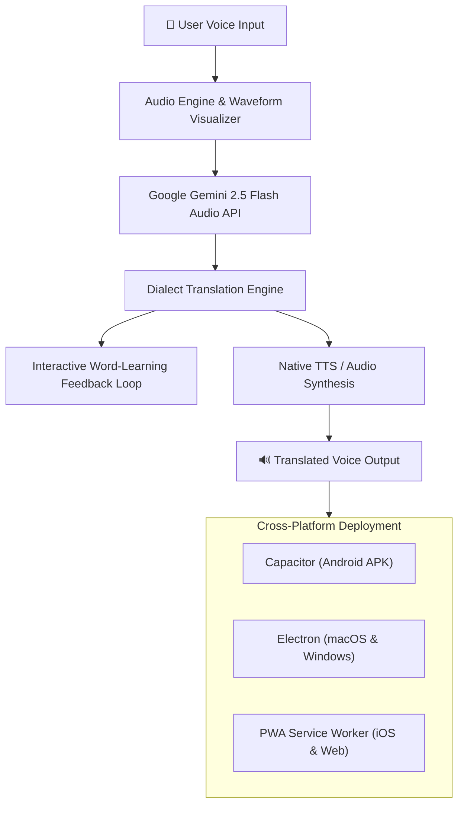

# 🌐 भाषासेतु (BhashaSetu) — Real-Time Indian Dialect Voice AI & Mesh Walkie-Talkie

<div align="center">

[](LICENSE)
[](https://github.com/happythakur4-beep/bhashasetu-/releases)
[](https://github.com/happythakur4-beep/bhashasetu-/actions)
[](https://ai.google.dev/)
[](https://react.dev/)
[](https://capacitorjs.com/)
[](https://www.electronjs.org/)

**भारत की विभिन्न क्षेत्रीय बोलियों (Regional Dialects) और भाषाओं को जोड़ने वाला रियल-टाइम वॉयस ट्रांसलेटर और ऑफलाइन मेश वॉकी-टॉकी।**

[🌐 **Live Web Demo**](https://echo-standings-highways-view.trycloudflare.com) • [📦 **Download Releases**](https://github.com/happythakur4-beep/bhashasetu-/releases) • [📖 **Features**](#-मुख्य-विशेषताएं-key-features) • [💻 **Setup Guide**](#-लोकल-सेटअप-local-development)

</div>

---

## 📖 परिचय (Overview)

भारत विविधताओं और सैकड़ों स्थानीय बोलियों का देश है। कई बार अंतर-राज्यीय यात्रा, आपदा राहत (Disaster Relief), दूरदराज के पहाड़ी इलाकों या स्थानीय व्यापार में भाषा की बाधा (Language Barrier) संवाद को मुश्किल बना देती है।

**भाषासेतु (BhashaSetu)** इसी समस्या का आधुनिक समाधान है। यह **Google Gemini 2.5 Flash** मल्टीमॉडल और रियल-टाइम ऑडियो टेक्नोलॉजी का उपयोग करके मानक भाषाओं (जैसे हिंदी, ओडिया) और आंचलिक बोलियों (जैसे मंडी की मंडयाली पहाड़ी / Mandali Pahadi) के बीच तत्काल वाक्-से-वाक् (Speech-to-Speech) अनुवाद संभव बनाता है। इसके साथ ही, नेटवर्क न होने की स्थिति में यह **ऑफलाइन मेश वॉकी-टॉकी** और **रडार मैप** के ज़रिए संचार की निरंतरता सुनिश्चित करता है।

---

## 📱 समर्थित प्लेटफ़ॉर्म (Multi-Platform Availability)

BhashaSetu को सिंगल मॉडर्न कोडबेस से सभी प्रमुख प्लेटफ़ॉर्म्स के लिए तैयार किया गया है:

| प्लेटफ़ॉर्म | पैकेज / फॉर्मेट | विवरण | स्टेटस |
| :--- | :--- | :--- | :--- |
| **Android** | `.apk` (Debug/Release) | Capacitor Native Shell, माइक & ऑडियो सपोर्ट | ✅ [APK डाउनलोड](https://github.com/happythakur4-beep/bhashasetu-/releases) |
| **macOS** | `.dmg` / `.zip` | Electron 33 Universal Desktop Build (Intel & Apple Silicon) | ✅ [Actions Artifacts](https://github.com/happythakur4-beep/bhashasetu-/actions) |
| **Windows** | `.exe` Installer / Portable | Electron 33 x64 Windows Desktop Application | ✅ [Actions Artifacts](https://github.com/happythakur4-beep/bhashasetu-/actions) |
| **iOS / Mobile Web**| Progressive Web App (PWA) | Safari "Add to Home Screen", ऑफ़लाइन सर्विस वर्कर | ✅ [Live App](https://echo-standings-highways-view.trycloudflare.com) |
| **Web Browser** | SPA / HTTPS Cloudflare | Chrome, Firefox, Safari, Edge आदि पर सीधा एक्सेस | ✅ [Live Demo](https://echo-standings-highways-view.trycloudflare.com) |

---

## ✨ मुख्य विशेषताएं (Key Features)

### 🎙️ 1. रियल-टाइम डुअल-टॉक वॉयस ट्रांसलेशन (Dual-Talk Voice Translation)
- दो वक्ता अपनी-अपनी भाषा/बोली में स्वाभाविक रूप से बात कर सकते हैं।
- **सपोर्टेड भाषाएँ व बोलियाँ**: हिंदी (Hindi), ओडिया (Odia), मंडयाली पहाड़ी (Mandali Pahadi - Himachal Pradesh) आदि।
- प्राकृतिक ऑडियो वेवफॉर्म विज़ुअलाइज़र और तुरंत स्पीच-टू-स्पीच प्लेबैक।

### 📻 2. पुश-टू-टॉक (PTT) वॉकी-टॉकी मोड
- पारंपरिक वायरलेस वॉकी-टॉकी रेडियो अनुभव।
- चैनल चयन (Channel 01 - Emergency, 02 - Transit, 03 - Local Trade)।
- बटन दबाकर बोलें और छोड़ते ही अनुवादित आवाज़ चैनल के सभी प्रतिभागियों तक पहुँचती है।

### 📡 3. ऑफलाइन मेश व लोकल इंटरकॉम (Offline Mesh & Radar)
- इंटरनेट कनेक्टिविटी न होने पर भी लोकल पीयर-टू-पीयर इंटरकॉम।
- **प्रॉक्सिमिटी रडार मैप (Proximity Radar)**: आसपास के एक्टिव मेश नोड्स, दूरी (मीटर में) और सिग्नल क्षमता का लाइव रडार डिस्प्ले।

### 🧠 4. इंटरएक्टिव बोली शब्द-सीखना (Dialect Nuance Feedback Loop)
- जब कोई नया या कम सुना जाने वाला क्षेत्रीय शब्द बोला जाता है, तो AI कन्फर्मेशन पॉपअप प्रस्तुत करता है।
- उपयोगकर्ता **"हाँ (सटीक है)"**, **"ना (गलत है)"**, या **"ठीक-ठाक (सुधार की आवश्यकता)"** चुनकर AI के ज्ञानकोष को तुरंत समृद्ध कर सकते हैं।

### 🔐 5. लचीला ऑथेंटिकेशन (Multi-Provider Authentication)
- भारतीय मोबाइल नंबर (+91) OTP सत्यापन सिमुलेशन।
- Google One-Tap साइन-इन।
- त्वरित शुरुआत के लिए गेस्ट मोड (Guest Access)।

### 📚 6. बोली वाक्यांश-पुस्तिका (Dialect Phrasebook & Audio Log)
- महत्वपूर्ण वाक्यों और आपातकालीन संदेशों की ऑफ़लाइन शब्दावली।
- पिछले सभी अनुवादित संवादों का समय और भाषा टैग के साथ संपूर्ण ऑडियो रिकॉर्ड।

---

## 🏗️ आर्किटेक्चर एवं तकनीक (Architecture & Tech Stack)



- **Frontend Core**: React 19, TypeScript, Vite
- **UI & Styling**: Tailwind CSS, Lucide Icons, HTML5 Canvas Visualizer
- **Mobile Container**: Capacitor 6 (`@capacitor/android`, `@capacitor/core`)
- **Desktop Container**: Electron 33 (`electron-builder`)
- **AI Engine**: Google Gemini 2.5 Flash / Gemini Live Audio SDK
- **CI/CD Pipeline**: GitHub Actions Multi-Matrix Runner (Ubuntu, macOS, Windows)

---

## 💻 लोकल सेटअप (Local Development)

### आवश्यकताएं (Prerequisites)
- [Node.js](https://nodejs.org/) (संस्करण 18 या नया)
- [npm](https://www.npmjs.com/) या [bun](https://bun.sh/)
- [Google Gemini API Key](https://aistudio.google.com/app/apikey)

### 1. रिपॉजिटरी क्लोन करें
```bash
git clone https://github.com/happythakur4-beep/bhashasetu-.git
cd bhashasetu-
```

### 2. डिपेंडेंसी इंस्टॉल करें
```bash
npm install
```

### 3. पर्यावरण चर (Environment Variables) सेट करें
`.env.local` फाइल बनाएं या अपडेट करें:
```env
GEMINI_API_KEY=your_gemini_api_key_here
```

### 4. डेवलपमेंट सर्वर शुरू करें
```bash
npm run dev
```
ब्राउज़र में `http://localhost:3000` पर ऐप खुल जाएगी।

---

## 📦 सभी प्लेटफ़ॉर्म्स के लिए बिल्ड कैसे बनाएं (Multi-Platform Build)

### 📱 Android APK बनाएं:
```bash
npm run build
npx cap sync android
cd android && ./gradlew assembleDebug
# APK स्थान: android/app/build/outputs/apk/debug/app-debug.apk
```

### 💻 macOS और Windows डेस्कटॉप ऐप्स बनाएं:
```bash
npm run build
npm run electron:build
# आउटपुट स्थान: release/
```

### 🌐 GitHub Actions ऑटोमेटेड क्लाउड बिल्ड:
रिपॉजिटरी में `.github/workflows/build-all-platforms.yml` शामिल है, जो हर `git push` पर स्वतः ही Android APK, macOS DMG और Windows EXE बनाकर **Actions Artifacts** में स्टोर करता है।

---

## 🤝 योगदान (Contributing)

भारतीय बोलियों के संरक्षण और संवर्धन में आपके योगदान का स्वागत है!
1. रिपॉजिटरी को Fork करें (`git fork`)
2. अपनी फ़ीचर ब्रांच बनाएं (`git checkout -b feature/NewDialectSupport`)
3. बदलाव कमिट करें (`git commit -m 'feat: Add Bhojpuri dialect support'`)
4. ब्रांच पुश करें (`git push origin feature/NewDialectSupport`)
5. एक नया Pull Request खोलें

---

## 📄 लाइसेंस (License)

यह प्रोजेक्ट [MIT License](LICENSE) के अंतर्गत ओपन-सोर्स है।

---

<div align="center">

❤️ गर्व से भारत में निर्मित (Proudly Built for India) | **भाषासेतु टीम**

</div>
